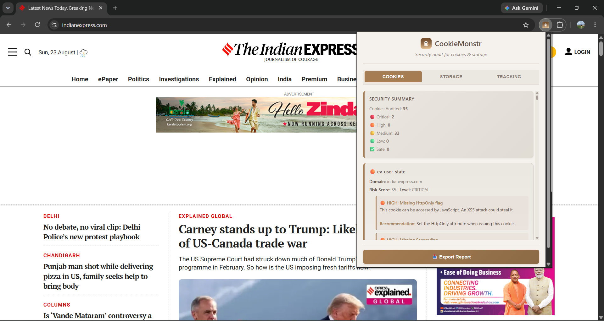
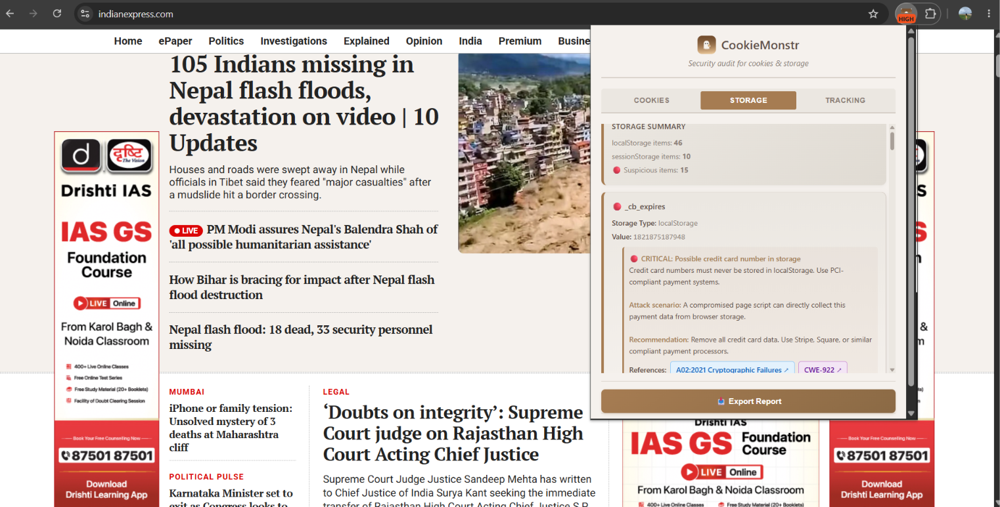
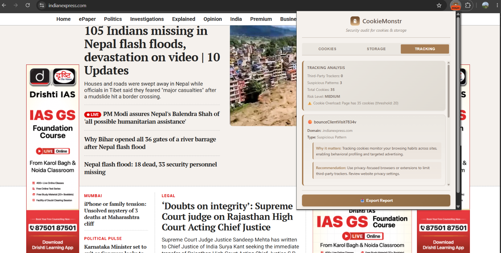
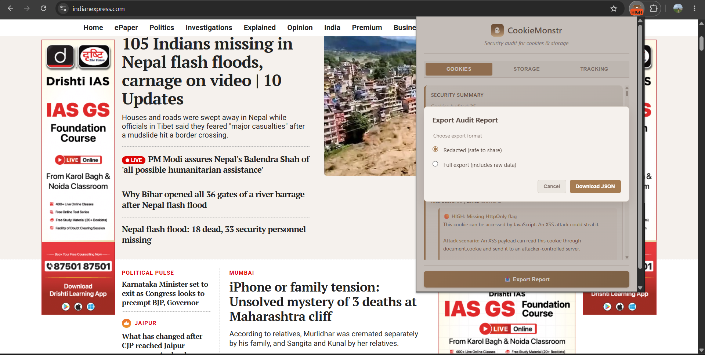
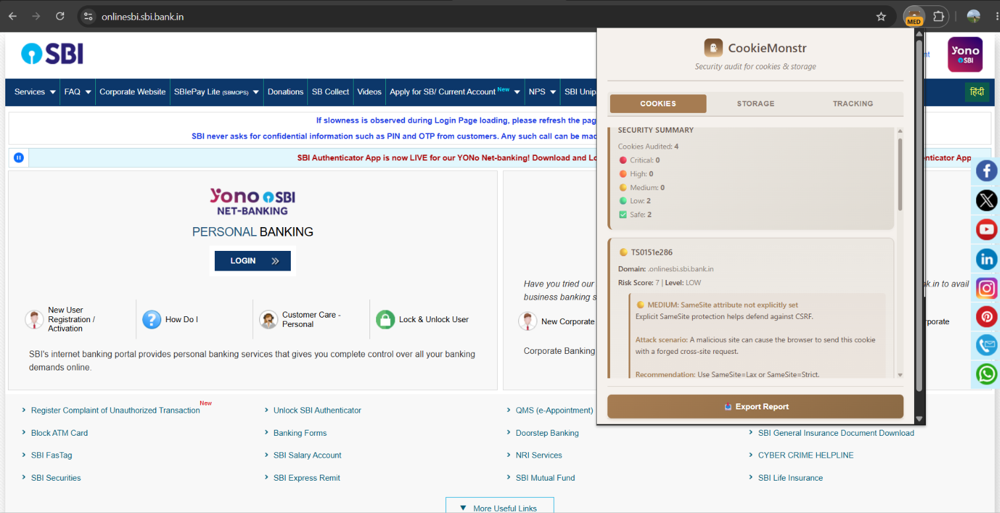
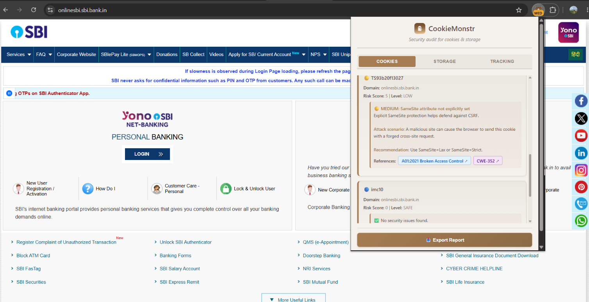
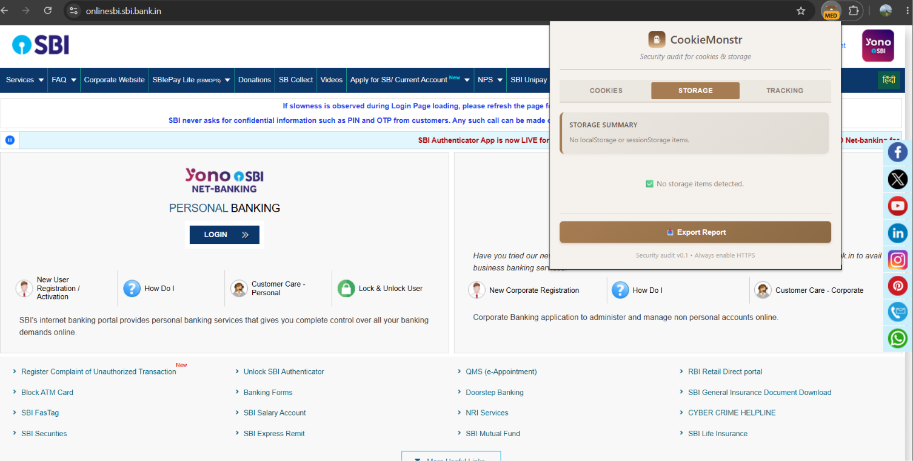
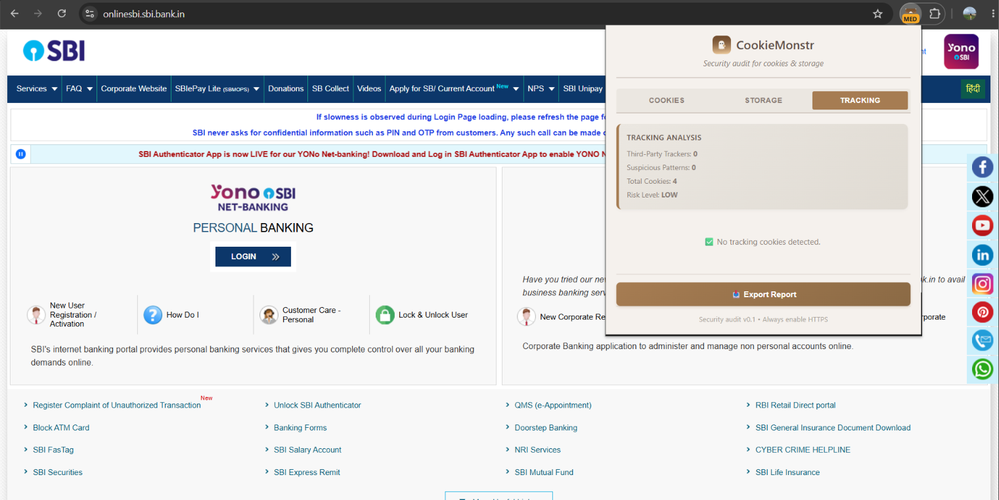

# CookieMonstr

**Local-first browser security research tool for cookies, web storage, and tracking signals.**

CookieMonstr is a Manifest V3 Chrome extension for inspecting the client-side security posture of a webpage. It audits cookie attributes, identifies sensitive values in `localStorage` and `sessionStorage`, detects tracking-related cookie signals, and produces JSON reports enriched with OWASP Top 10 and CWE references.

The project is intended for security research, defensive testing, education, and responsible disclosure workflows. It does not exploit findings, modify browser state, or transmit audit data to a remote service.

## Research Focus

CookieMonstr helps answer practical questions during a client-side security review:

- Are authentication and session cookies protected with `HttpOnly`, `Secure`, and `SameSite` attributes?
- Is sensitive information being persisted in JavaScript-readable web storage?
- Are third-party or tracking-oriented cookie patterns present?
- Which OWASP Top 10 categories and CWE classes are associated with the findings?
- Can an audit be shared safely without exposing raw storage values?

It is a visibility and triage tool, not a replacement for application testing, source review, network inspection, or a full DAST/SAST platform.

---

## Browser Audit Case Studies

CookieMonstr was exercised against publicly accessible webpages to observe cookie configurations, browser-storage entries, and tracking-related indicators.

The following case studies demonstrate how the extension collects and presents security findings in different browsing environments. Results are based on the browser state and page content observed during individual audits. They are not comprehensive security assessments of the organizations or evidence of confirmed exploitable vulnerabilities.

The screenshots and counts represent observations from the recorded audits and may change as websites update their configurations or CookieMonstr's detection logic evolves.

### The Indian Express (indianexpress.com) — Browser Audit Case Study

<p float="left">
  
  
  
  
</p>


| Metric | Result |
|---|---|
| Cookies audited | 35 |
| Critical | 2 |
| Medium | 33 |
| localStorage items | 46 |
| sessionStorage items | 10 |
| Suspicious storage items | 15 |
| Third-party trackers | 0 |
| Suspicious tracking patterns | 3 |
| Toolbar badge | 🟠 HIGH |

**Cookie findings:** During the recorded audit, CookieMonstr inspected 35 cookies and identified several missing or potentially weak security attributes. Two cookies received Critical risk classifications under the scoring model used at the time. For example, `ev_user_state` was reported as lacking `HttpOnly` and `Secure` attributes. These settings can be relevant to client-side access and transport security, although the actual security impact depends on the cookie's purpose, authentication role, and application configuration.

**Storage findings:** CookieMonstr inspected 46 localStorage entries and 10 sessionStorage entries, flagging 15 items as potentially sensitive. One entry, `_cb_expires`, contained a 13-digit numeric value that matched the auditor's credit-card detection heuristic. This was an unverified pattern match, not evidence that a payment-card number was exposed. Numeric timestamps, identifiers, and other application values may produce similar matches.

**Tracking findings:** The audit reported no matches against its known third-party tracker-domain list, three suspicious naming patterns, and a cookie-count warning. These results identify potential tracking-related indicators rather than establishing malicious behavior or a complete inventory of tracking activity.

**Export:** CookieMonstr provides a redacted JSON export intended to reduce exposure of sensitive browser-storage values. Automated regression tests verify redaction for selected synthetic authentication-token and payment-card scenarios. Redaction is not a guarantee that every possible secret or identifying value has been removed; exported reports should be reviewed before sharing.

*Interpretation:* These observations demonstrate CookieMonstr's ability to surface potentially relevant browser-security indicators. No confirmed vulnerability or payment-data exposure is asserted for this website.
---

### SBI Net Banking — Browser Audit Case Study

<p float="left">
  
  
  
  
</p>

| Metric | Result |
|---|---|
| Cookies audited | 4 |
| Critical | 0 |
| High | 0 |
| Medium | 0 |
| Low | 2 |
| Safe | 2 |
| localStorage items | 0 |
| sessionStorage items | 0 |
| Third-party trackers | 0 |
| Suspicious tracking patterns | 0 |
| Toolbar badge | 🟡 MED |

**Cookie and storage observations:** During the recorded audit, CookieMonstr identified four cookies, no accessible localStorage or sessionStorage entries, and no tracking-related matches within its configured detection rules. Two cookies received a SAFE classification, while two received low or medium risk classifications under the scoring model used at the time.

**SameSite findings:** The cookies `TS0151e286` and `TS93b20f13027` were reported as lacking explicitly configured SameSite attributes. CookieMonstr identifies this condition as a potential configuration-hardening opportunity and provides CWE-352 and OWASP-related references.

A missing explicit SameSite attribute does not independently demonstrate cross-site request forgery. Modern browsers generally apply Lax-by-default behavior, and effective CSRF protection depends on additional application and browser controls.

**Interpretation:** This case study demonstrates how CookieMonstr reports a comparatively small number of browser-security findings for the observed page state. It does not establish that the banking application is free of vulnerabilities, trackers, or other security risks.

**Comparison:** The two recorded audits illustrate how CookieMonstr presents different cookie counts, browser-storage observations, tracking indicators, and heuristic risk classifications across webpages.

*Note:* These results are historical observations and have not been independently revalidated against the latest CookieMonstr implementation.


## Capabilities

### Cookie Security Audit

The background service worker retrieves cookies associated with the active webpage through the Chrome Cookies API. CookieMonstr evaluates cookie attributes using six heuristic security rules.

| Finding | Severity | Reference |
|---|---|---|
| Missing `HttpOnly` | High | CWE-1004 |
| Missing `Secure` on likely session cookies | High | CWE-614 |
| Missing explicit `SameSite` | Medium | CWE-352 |
| `SameSite=None` without `Secure` | High | CWE-352 |
| Broad cookie domain scope | Low | CWE-732 |
| Long-lived authentication cookie | Medium | CWE-613 |

The duplicate Secure-attribute detection was removed during regression testing to prevent multiple findings for the same underlying condition from inflating risk scores.

**Risk scoring**

CookieMonstr assigns weighted scores to findings:

- High: 10 points
- Medium: 5 points
- Low: 2 points
- Informational: 0 points

The resulting risk classifications are `SAFE`, `LOW`, `MEDIUM`, `HIGH`, and `CRITICAL`.

These scores support prioritization of potential issues. They are not quantitative measurements of exploitability, attack probability, or business impact.

**Validation:** Six cookie-security rules were evaluated against 24 controlled scenarios, with 11 true positives, 13 true negatives, and no observed misclassifications on that dataset.

### Web Storage Analysis

The content script reads page-local `localStorage` and `sessionStorage` and passes the values to the storage audit logic. Detection covers:

- API keys and secrets
- JWT, OAuth, bearer, and other authentication tokens
- Passwords and session identifiers
- Email addresses
- Credit card numbers and SSNs
- PEM private keys

Values displayed in the popup are truncated. Access may be unavailable on restricted browser pages or pages where the content script cannot run.

### Tracking Signals

The Tracking tab identifies known tracker domains and suspicious cookie naming patterns. It also reports cookie overload when a page has more than 20 cookies and assigns a tracking risk level based on detected signals.

This is heuristic detection. A tracker match does not prove malicious behavior, and the absence of a match does not prove that a page is free of tracking.

### Toolbar Severity Badge

After a page finishes loading, the extension silently audits its cookies and updates the toolbar badge with the highest finding severity:

| State | Badge | Color |
| --- | --- | --- |
| Critical finding | `CRIT` | Red |
| High finding | `HIGH` | Orange |
| Medium finding | `MED` | Amber |
| Low or informational finding | `LOW` | Green |
| No findings | `✓` | Grey |

Opening the popup also refreshes the badge for the active tab in case the service worker was idle during navigation.

### JSON Reporting

CookieMonstr generates structured JSON reports containing cookie findings, browser-storage observations, tracking indicators, risk classifications, timestamps, page URLs, and applicable OWASP/CWE references.

Two export modes are supported:

- **Redacted export (default):** Applies heuristic redaction to potentially sensitive browser-storage values and relevant storage findings. The implementation includes checks for sensitive key names, email addresses, IP addresses, nested JSON fields, and token-like values.
- **Full export:** An explicitly selected option that preserves raw browser-storage values for authorized private analysis.

**Security improvements:** Automated regression testing identified and addressed a data-disclosure issue where sensitive storage values could remain visible within exported security findings even when storage-item redaction was enabled.

The corrected export logic preserves security findings while redacting flagged values in the tested scenarios.

Redaction operates on a separate report representation without intentionally modifying the original audit state.

**Privacy limitation:** Redaction is heuristic and has not been exhaustively verified across every report field or sensitive-data format. Reports may contain sensitive URLs, identifiers, cookie metadata, or other contextual information. Users should review redacted reports before sharing them publicly and handle full exports as sensitive artifacts.

## OWASP and CWE Mapping

Mapped findings currently cover these OWASP Top 10 categories:

- **A01:2021 - Broken Access Control**: SameSite and CSRF-related cookie exposure
- **A02:2021 - Cryptographic Failures**: Sensitive information and credentials in browser storage
- **A05:2021 - Security Misconfiguration**: Cookie configuration and domain-scope issues
- **A07:2021 - Identification and Authentication Failures**: Session and authentication cookie/token issues

Each mapped finding can include an OWASP category, CWE identifier, MITRE reference URL, and a concise attack scenario. These mappings describe vulnerability classes; they are not CVE identifiers and do not assert that a specific software vulnerability exists.

## Installation

CookieMonstr is currently installed from source as an unpacked extension.

1. Clone or download this repository.
2. Open `chrome://extensions/` in Chrome.
3. Enable **Developer mode**.
4. Select **Load unpacked**.
5. Choose the project directory.
6. Pin CookieMonstr to the toolbar for badge visibility.

After code changes, use **Reload** on the extension card. Reload the target webpage when testing content-script behavior.

## Usage

1. Navigate to a permitted webpage.
2. Wait for the page to finish loading so the toolbar badge can update.
3. Open CookieMonstr from the toolbar.
4. Review the **Cookies**, **Storage**, and **Tracking** tabs.
5. Select **Export Report** to choose a redacted or full JSON report.
6. Use the OWASP and CWE reference badges to open authoritative documentation in a new tab.

Do not test systems without authorization. When using findings for disclosure, minimize collected data and prefer the redacted export unless raw values are strictly required for private analysis.

## Architecture

```text
Active webpage
    |
    | content_scripts/storage_reader.js
    v
Popup ----------------------------+
    |                             |
    | GET_COOKIES                 | GET_STORAGE
    v                             v
Service worker              Storage audit
    |                             |
    v                             v
Cookie audit + rules        Enriched findings
    |                             |
    +-------------+---------------+
                  v
       Popup rendering and export
                  |
                  v
        Redacted/full JSON report
```

## Repository Structure

```text
CookieMonstr/
├── .github/
│   └── workflows/
│       └── security-tests.yml       # Automated GitHub Actions CI
│
├── assets/
│   ├── icons/                  # Extension icons
│   └── screenshots/            # Browser audit screenshots
│
├── background/
│   └── service_worker.js       # Cookie retrieval, audit requests, badge
│
├── content_scripts/
│   └── storage_reader.js       # Browser storage collection
│
├── lib/
│   ├── cookieAudit.js          # Cookie audit and severity ordering
│   ├── cookieRules.js          # Six cookie security rules
│   ├── export.js               # JSON reporting and redaction
│   ├── mappings.js             # OWASP/CWE metadata
│   ├── riskScore.js            # Risk scoring and aggregation
│   ├── storageAudit.js         # Sensitive storage detection
│   └── trackingDetector.js     # Tracking-related indicators
│
├── popup/
│   ├── popup.html              # Extension interface
│   ├── popup.css               # Popup styling
│   └── popup.js                # Audit rendering and interactions
│
├── tests/
│   ├── cookieRules.test.js     # Cookie-rule unit tests
│   ├── cookieAudit.test.js     # Cookie-audit integration tests
│   ├── export.test.js          # Export redaction regression tests
│   ├── storageMetadata.test.js # Storage false-positive regression tests
│   └── storageAdversarial.test.js
│                               # Storage edge-case tests
│
├── evaluation/
│   ├── validation/
│   │   ├── storage-cases.json       # Storage development fixtures
│   │   └── final-storage-cases.json # Additional storage fixtures
│   │
│   ├── storageAccuracy.js      # Initial password-rule evaluation
│   ├── passwordHoldout.js      # Additional password development cases
│   ├── securityBenchmark.js    # Multi-rule development benchmark
│   ├── runValidation.js        # Labeled storage evaluation runner
│   └── cookieValidation.js     # Cookie rule-conformance evaluation
│
├── manifest.json              # Chrome extension configuration
├── package.json               # Node.js test configuration
└── README.md                  # Documentation and validation results
```

## Permissions and Privacy

| Permission | Purpose |
| --- | --- |
| `cookies` | Read cookies associated with the active URL for analysis |
| `activeTab` | Identify the current page and support popup actions |
| `scripting` | Support page interaction required by the extension |
| `<all_urls>` | Allow audits across supported websites |

CookieMonstr is local-first:

- Audit processing runs in the browser.
- No audit data is uploaded to a CookieMonstr server.
- Cookies and storage are read but not modified.
- The extension does not create user accounts or collect browsing history.
- Chrome system and extension pages are excluded from auditing.

Because the extension can inspect sensitive browser data, use it only on systems and websites where you have permission. Treat full exports as sensitive artifacts and store them securely.

## Security Testing and Detection Validation

CookieMonstr includes automated unit, integration, security regression, and report-redaction tests implemented using Node.js's built-in test runner. GitHub Actions executes the automated test suite on pushes and pull requests targeting `main`.

### Automated Regression Testing

The automated test suite validates:

- Cookie security rule behavior and finding classification
- Risk-score calculations and severity ordering for selected scenarios
- Prevention of duplicate cookie security findings
- Sensitive-value redaction in JSON security reports
- Browser-storage detection behavior and known false-positive regressions

**Latest verified regression suite:** 25 tests passed, 0 failed.

### Detection Accuracy Evaluation

Detection behavior was evaluated using synthetic, labeled browser-security scenarios with predefined expected outcomes.

The evaluation measures true positives (TP), true negatives (TN), false positives (FP), false negatives (FN), precision, recall, F1 score, and error rates.

#### Cookie Security Evaluation

Six cookie-security rules were evaluated across 24 controlled cases.

| Metric | Result |
|---|---:|
| Test cases | 24 |
| True positives | 11 |
| True negatives | 13 |
| False positives | 0 |
| False negatives | 0 |
| Precision | 100% |
| Recall | 100% |
| F1 score | 100% |

The tested rules cover missing `HttpOnly`, missing `Secure`, unspecified `SameSite`, `SameSite=None` without `Secure`, broad cookie domains, and long-lived authentication cookies.

These results demonstrate conformance with the expected outcomes of the selected synthetic configurations, not comprehensive real-world detection accuracy.

#### Browser Storage Detection — Development Evaluation

Three storage detection rules were evaluated across 18 controlled cases.

| Metric | Before refinement | After refinement |
|---|---:|---:|
| Test cases | 18 | 18 |
| True positives | 9 | 9 |
| True negatives | 5 | 9 |
| False positives | 4 | 0 |
| False negatives | 0 | 0 |
| Precision | 69.23% | 100% |
| Recall | 100% | 100% |
| F1 score | 81.82% | 100% |

The refinements reduced observed false positives in password, API-key, and session-identifier detection.

These cases informed the detection improvements and therefore represent development-set results.

#### Additional Storage Detection Evaluation

Four additional storage detection rules were evaluated across 16 controlled cases.

| Detection rule | Precision | Recall | F1 score |
|---|---:|---:|---:|
| JWT/token exposure | 66.67% | 100% | 80% |
| Credit-card exposure | 66.67% | 100% | 80% |
| Private-key marker exposure | 100% | 50% | 66.67% |
| Email exposure | 50% | 100% | 66.67% |

**Combined results:** 7 true positives, 4 true negatives, 4 false positives, and 1 false negative.

Observed limitations included configuration metadata incorrectly flagged as sensitive, a numeric order identifier misclassified as payment-card data, and an encrypted private-key marker not detected.

These cases evaluate selected heuristic and format-matching behaviors, not credential validity or exploitability.

### Reproducing the Evaluation

Run the automated regression suite:

```bash
npm test
```

Run the controlled cookie-security evaluation:

```bash
node evaluation/cookieValidation.js
```

Run the original storage development evaluation:

```bash
node evaluation/runValidation.js storage-cases.json
```

Run the additional storage evaluation:

```bash
node evaluation/runValidation.js final-storage-cases.json
```

### Interpretation

All evaluation results are based on limited synthetic datasets. Some fixtures overlap conceptually with development examples, and the datasets have not been independently sampled or validated against representative real-world applications.

The reported metrics describe performance on the specified test cases only. They should not be interpreted as overall vulnerability-detection accuracy, exploitability measurements, or guarantees against false positives and false negatives.

## Limitations and Interpretation

CookieMonstr is a heuristic-based browser security auditing tool designed to identify potential security weaknesses in cookies, browser storage, and tracking-related behavior. Its findings should be interpreted as indicators for further investigation rather than definitive evidence of exploitable vulnerabilities.

### Detection Limitations

- **Cookie Security:** Cookie findings rely on attributes exposed by the Chrome Cookies API and heuristic identification of likely session cookies. The auditor cannot independently verify server-side session management or authentication behavior.
- **Browser Storage:** Detection relies on recognizable key names and supported value patterns. Sensitive credentials stored under generic, misleading, or unconventional key names may not be detected.
- **False Positives and False Negatives:** Security-related configuration fields may resemble credential fields, while some sensitive values may not match existing detection patterns. Although detection heuristics have been refined through controlled testing, incorrect classifications remain possible.
- **Storage Access:** The storage reader can inspect only page contexts where the extension's content scripts are permitted to execute.
- **Tracking Detection:** Tracking-related findings are based on domain and naming heuristics. CookieMonstr does not provide a comprehensive network-level inventory of tracking activity.
- **Scope:** The extension does not inspect server-side session invalidation, application authorization logic, TLS configuration, or HTTP response bodies.

### Testing and Validation Limitations

- CookieMonstr includes automated unit, integration, security regression, and redaction tests using Node.js's built-in test runner.
- Automated tests are executed through GitHub Actions on pushes and pull requests targeting the `main` branch.
- Detection accuracy has been evaluated using controlled, synthetically generated test cases with predefined expected outcomes.
- Precision, recall, false-positive rates, false-negative rates, and F1 scores are calculated for selected browser-storage detection rules.
- Some evaluation cases were used to refine detection heuristics. Consequently, their results represent development-set performance rather than independent validation.
- The evaluated datasets are limited in size and do not establish detection accuracy across real-world websites, authentication systems, or browser configurations.
- Automated tests do not replace manual validation of extension behavior in Chrome.

### Security Interpretation

CookieMonstr findings represent potential security risks requiring contextual review. A reported finding does not, by itself, establish exploitability, successful credential compromise, or business impact. Risk scores are heuristic prioritization indicators rather than quantitative measurements of real-world attack likelihood.


## Development

CookieMonstr is built using:

- Chrome Extension Manifest V3
- Vanilla JavaScript with ES modules
- Chrome extension APIs
- HTML and CSS
- Node.js built-in test runner
- GitHub Actions for continuous integration

The extension does not require a frontend build process or runtime npm dependencies. Node.js is used for automated testing and detection evaluation.

### Local Development

Edit the source files in VS Code and reload the unpacked extension through `chrome://extensions/`.

Reload the target webpage when testing changes affecting content scripts or page-state collection.

### Automated Testing

Run the complete automated regression suite:

```bash
npm test
```

The current suite contains 25 automated tests covering cookie rules, audit behavior, storage-detection regressions, selected risk-score behavior, and JSON export redaction.

### Security Evaluation

Run the cookie-rule evaluation:

```bash
node evaluation/cookieValidation.js
```

Run the storage development evaluation:

```bash
node evaluation/runValidation.js storage-cases.json
```

Run the additional storage evaluation:

```bash
node evaluation/runValidation.js final-storage-cases.json
```

Evaluation scripts report detection classifications and metrics for labeled synthetic test scenarios.

### Continuous Integration

GitHub Actions runs the automated regression suite on pushes and pull requests targeting the `main` branch.

The workflow uses a GitHub-hosted runner to verify that previously tested functionality continues to behave as expected.

### Manual Validation

Automated tests are complemented by manual extension testing in Chrome, including checks for:

- Cookie and storage findings
- Popup rendering and navigation
- Toolbar badge updates
- Tracking indicators
- External security-reference links
- Redacted and full JSON exports

Manual testing should use authorized environments and synthetic data whenever practical.

## Roadmap

### Completed

- Automated cookie-security rule tests and audit integration tests
- Security regression testing using Node.js
- Duplicate cookie-finding correction
- JSON report-redaction improvements
- Controlled detection accuracy evaluation using labeled synthetic cases
- False-positive analysis and refinement of selected storage rules
- GitHub Actions continuous integration

### Potential Future Improvements

- Broader adversarial and independently sourced validation datasets
- Improved detection of sensitive values stored under unconventional keys
- Stronger payment-card and credential-format validation
- Historical audit comparison and trend reporting
- Network-aware tracking detection
- Configurable detection rules and severity thresholds

These are potential extensions rather than requirements for the current project version.

## References

- [Chrome Extensions documentation](https://developer.chrome.com/docs/extensions/)
- [Chrome Cookies API](https://developer.chrome.com/docs/extensions/reference/api/cookies)
- [OWASP Top 10](https://owasp.org/www-project-top-ten/)
- [OWASP Session Management Cheat Sheet](https://cheatsheetseries.owasp.org/cheatsheets/Session_Management_Cheat_Sheet.html)
- [OWASP Cookie Security](https://owasp.org/www-community/controls/Cookie_Security)
- [MITRE CWE](https://cwe.mitre.org/)
- [MDN Web Storage API](https://developer.mozilla.org/en-US/docs/Web/API/Web_Storage_API)

## Author

**Urvija Kapila**  
Email: kapila.urvija@gmail.com  
B.Tech CSE (Cyber Security), Dayananda Sagar University

---

*Built as part of an independent security research portfolio. All findings on third-party sites are documented for educational purposes only.*
